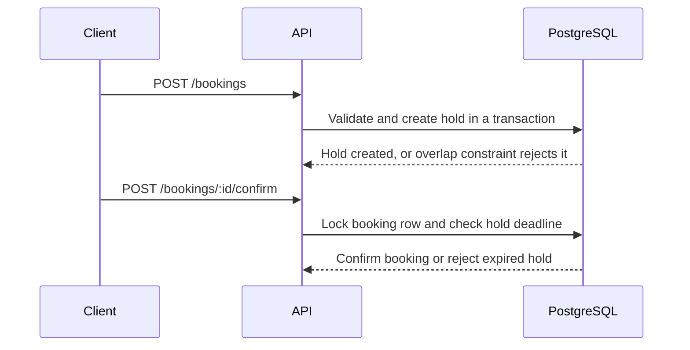

# Immigration Advisor Booking API

A REST API for booking immigration consultations with Lifted's advisors, Sofia Andersson (`ia-001`) and Rajan Patel (`ia-002`).

The visa type determines the appointment length:

- **A — Skilled Worker:** 30 minutes
- **B — Family / Dependent:** 60 minutes

When a candidate requests a slot, it is held for 10 minutes while the advisor confirms it. If the hold expires without confirmation, the slot becomes available again.

## Features

- Availability derived from advisor availability windows
- Optional availability filters by advisor and visa type
- Ten-minute booking holds and confirmation
- Paginated booking list with optional status filter
- Consistent success responses and client-facing error codes
- PostgreSQL-enforced overlap protection
- OpenAPI documentation and integration tests

## API overview

| Method | Path                    | Purpose                                                                    |
| ------ | ----------------------- | -------------------------------------------------------------------------- |
| `GET`  | `/health`               | Liveness check                                                             |
| `GET`  | `/docs`                 | Swagger UI                                                                 |
| `GET`  | `/docs/json`            | OpenAPI 3.0 document                                                       |
| `GET`  | `/availability`         | List bookable slots; optional `advisorId` and `visaType`                   |
| `POST` | `/bookings`             | Hold a slot using `candidateName`, `visaType`, `advisorId`, and `startsAt` |
| `POST` | `/bookings/:id/confirm` | Confirm a pending hold                                                     |
| `GET`  | `/bookings`             | List bookings; optional `status`, `page`, and `limit`                      |

Successful availability and booking responses use the shared `{ "success": true, "data": ... }` format. Booking errors use stable codes:

- `400 invalid_request`
- `404 advisor_not_found`, `booking_not_found`
- `409 slot_unavailable`, `hold_expired`, `not_held`

## How it works



### Availability

Advisor windows are stored in `availability_windows`; individual slots are calculated when requested rather than stored separately.

Slots start on a 30-minute grid from the beginning of each availability window. A slot is returned only if the full appointment fits inside that same window and does not overlap an active hold or confirmed booking. Adjacent windows are not merged, so gaps between them remain unavailable.

The seeded availability was moved from the brief's March 2025 dates to **November 2026** so the sample data is in the future. The seed is in `data/advisors.json`.

### Booking holds

`createBooking` validates the advisor, visa type, appointment duration, start-time grid, and availability window. Within a database transaction, it expires elapsed overlapping holds, checks for conflicts, and creates a hold with a deadline ten minutes in the future.

The database clock is used for hold deadlines so multiple API instances use the same time reference.

### Confirmation and expiry

Confirmation locks the booking row with `SELECT ... FOR UPDATE`.

- A valid hold is marked `confirmed` and receives a `confirmed_at` timestamp.
- An expired hold is marked `expired` and returns `409 hold_expired`.
- A booking that is already confirmed is returned as-is, making repeated confirmation requests idempotent.
- A cancelled or otherwise non-held booking returns `409 not_held`.

There is no background expiry worker in this assessment version. Expired holds are ignored when calculating availability, and are marked `expired` when a new overlapping booking request or a confirmation request encounters them. As a result, a stale hold can still appear as `held` in `GET /bookings` until it is touched.

The confirmation endpoint is not authenticated in this version. In a real deployment, only the assigned advisor or an authorised staff member should be able to confirm a booking.

### Preventing double bookings

The application checks for overlaps inside the booking transaction. PostgreSQL provides the final safeguard through the `bookings_no_overlap` exclusion constraint in `drizzle/0000_create_booking_tables.sql`. It prevents overlapping `held` and `confirmed` appointments for the same advisor, including when requests reach different API instances.

The constraint uses half-open time ranges (`[)`), so one appointment may start exactly when another ends. The database also prevents overlapping availability windows. Both constraints require the PostgreSQL `btree_gist` extension.

PostgreSQL exclusion violations (`23P01`) and attempts to book outside an availability window (`23514`) are mapped to `409 slot_unavailable`.

## Run locally

### Prerequisites

- Node.js `>=22.18`
- pnpm `10.30.0` (enabled through Corepack; see `packageManager` in `package.json`)
- Docker

### Setup

```bash
corepack enable
pnpm install
cp .env.example .env
pnpm db:up
pnpm db:migrate
pnpm db:seed
pnpm dev
```

The API runs at `http://localhost:3000` by default. Open Swagger UI at `http://localhost:3000/docs`.

### Environment variables

Environment variables are validated in `src/config/env.ts`. Values already set in the shell take precedence over `.env`.

| Variable       | Description                                                                                        |
| -------------- | -------------------------------------------------------------------------------------------------- |
| `NODE_ENV`     | `development` by default; also supports `test` and `production`                                    |
| `HOST`         | Bind address; defaults to `0.0.0.0`                                                                |
| `PORT`         | Port; defaults to `3000`                                                                           |
| `LOG_LEVEL`    | Log level; defaults to `info`                                                                      |
| `CORS_ORIGIN`  | Comma-separated allowed origins; empty disables CORS                                               |
| `DATABASE_URL` | Required outside development; development defaults to `postgres://ia:ia@localhost:5432/ia_booking` |

### Database commands

- `pnpm db:up` starts PostgreSQL 17 using `infra/dev/compose.yaml` on `127.0.0.1:5432`. The local setup creates both `ia_booking` and `ia_booking_test` and enables `btree_gist` in each.
- `pnpm db:down` stops the container and keeps the data volume.
- `pnpm db:migrate` applies migrations to the database in `DATABASE_URL`.
- `pnpm db:seed` loads the advisor and availability data. It updates advisor names, skips windows that already have the same `(advisor_id, starts_at)`, and refuses to run in production.
- `pnpm db:reset` resets the local application and test databases. Use only for local development.

### Example request flow

List Sofia's available Skilled Worker slots:

```bash
curl -s 'http://localhost:3000/availability?advisorId=ia-001&visaType=A' | jq .
```

Create a hold:

```bash
curl -s -X POST http://localhost:3000/bookings \
  -H 'Content-Type: application/json' \
  -d '{
    "candidateName": "Alex Candidate",
    "visaType": "A",
    "advisorId": "ia-001",
    "startsAt": "2026-11-10T09:00:00Z"
  }' | jq .
```

Confirm the hold using the `id` returned by the previous request:

```bash
curl -s -X POST "http://localhost:3000/bookings/<booking-id>/confirm" | jq .
```

## Tests and quality checks

The test database must be migrated once before running the integration tests:

```bash
DATABASE_URL=postgres://ia:ia@127.0.0.1:5432/ia_booking_test pnpm db:migrate
pnpm test
```

The integration tests use Fastify's `app.inject()` and do not need to bind a network port.

Other checks:

```bash
pnpm typecheck
pnpm lint
pnpm build
pnpm build && pnpm start
```

### Test coverage

The tests cover availability filtering and slot calculation, the 10-minute hold lifecycle, rebooking after expiry, invalid requests, confirmation outcomes, and the effect of confirmed or cancelled bookings on availability. They also race two database connections against the same slot: one hold is created, and the other request returns `409 slot_unavailable`.

Also not implemented or tested: waitlist behaviour, advisor break buffers, authentication, a cancellation endpoint, and a background hold-expiry job.

## Design decisions and trade-offs

- **REST and Fastify:** straightforward endpoints, request validation with JSON Schema, and OpenAPI documentation generated from route schemas.
- **Feature-based modular structure:** each feature separates routes, business logic, and database access. Shared slot and visa rules live in `src/shared/`.
- **PostgreSQL and Drizzle:** Drizzle provides typed database access, while committed SQL migrations make the exclusion constraints, window-fit trigger, and indexes explicit.
- **Slots are derived:** availability windows are the source data; booking rows track the hold and confirmation lifecycle. This avoids maintaining a separate table of generated slots.
- **Database-enforced overlap protection:** an application-only availability check can race under concurrent requests. The PostgreSQL exclusion constraint provides the final guard.

Given the time limit, I prioritised the main availability and booking lifecycle, database-level overlap protection, a repeatable local setup, and tests for the core flows. I left the waitlist and break buffers out rather than implement them without enough time to verify the behaviour.

## Production considerations

This is an assessment implementation, not a production-ready service. Before deploying it, I would prioritise:

- **Authentication and authorisation:** restrict confirmation to the assigned advisor or authorised staff, and scope booking-list access by role.
- **Expiry cleanup:** add a scheduled job to mark elapsed holds as expired. Availability already ignores elapsed holds, but cleanup would keep booking lists and operational metrics accurate.
- **Cancellation and waitlist workflows:** expose cancellation as an API operation, then define how released slots are offered to eligible waitlisted candidates.
- **Advisor break buffers:** include the required post-appointment buffer in conflict detection and availability calculations.
- **Operational safeguards:** add rate limits, database readiness checks, query and conflict metrics, statement timeouts, and a bounded retry strategy for appropriate transient failures.
- **API versioning and backward compatibility:** Introduce an explicit API versioning strategy before external adoption, such as /api/v1, to allow future contract changes without unexpectedly breaking existing clients. Document API changes, maintain backward compatibility where practical, and define a deprecation process for older versions.
- **Deployment discipline:** run migrations as a release step, manage secrets outside source control, and ensure the required `btree_gist` extension is available in the target PostgreSQL instance.
- **Scale:** the current in-memory slot calculation is appropriate for two advisors and a small seed dataset. If availability grows substantially, I would move more of the calculation into SQL or introduce carefully invalidated caching, and paginate availability results.
- **Observability and instrumentation:** Add structured, correlated logs and instrument the request lifecycle with metrics and distributed traces. Track request latency and error rates, booking and confirmation outcomes, hold expirations, database query latency, and exclusion-constraint conflicts. Propagate request or correlation IDs across application logs and relevant operations. Expose service-health and database-readiness signals, and configure dashboards and actionable alerts to help detect, diagnose, and resolve issues quickly. Keep instrumentation lightweight and avoid logging candidate personal data or other sensitive information.

## AI tooling

I used Cursor as an augmentation tool during development for the initial codebase setup and boilerplate, configuration files, API documentation, and suggestions for code optimisation. I remained responsible for the architecture and implementation decisions, reviewed and adapted generated output to fit the requirements, and checked the resulting code against the brief. I ran `pnpm test`, `pnpm typecheck`, and `pnpm lint`.
